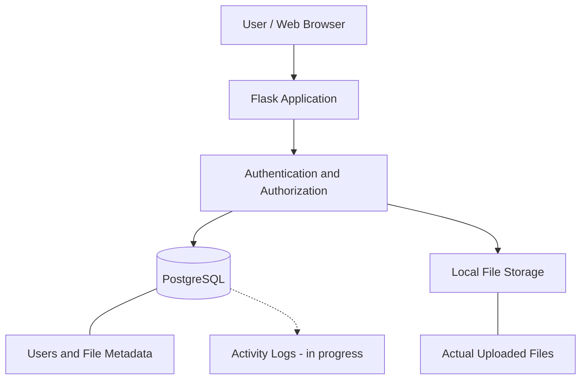
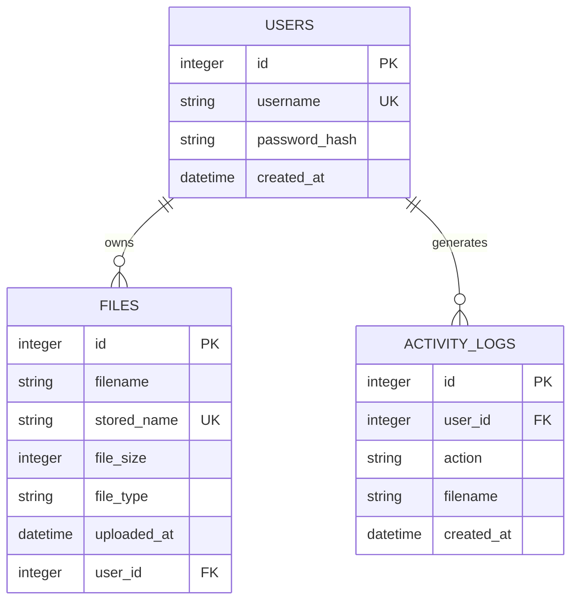

# CloudBox — Cloud-Native File Management

CloudBox is a cloud-style file storage application inspired by Google Drive and Dropbox. It is being built as a hands-on portfolio project to explore software development, cloud engineering, DevOps, and cybersecurity using free, locally hosted tools.

**Project status:** In active development. The core file management, PostgreSQL integration, authentication, and ownership controls have been implemented. Activity logging is the current development milestone. Docker, CI, and Kubernetes are planned, not yet implemented.

## Project scenario

Imagine a small company that needs an internal platform where employees can securely store and manage their own files. Employees create accounts, log in, upload files, and manage them from a personal dashboard. Each employee should only be able to access their own files.

The long-term goal is to build an application that can run in containers and be deployed to a Kubernetes cluster, without requiring a paid cloud account. The project currently runs locally and does not use AWS, Azure, or Google Cloud.

## Features and development progress

| Feature | Status |
| --- | --- |
| Flask web application and basic dashboard | Implemented |
| File upload, listing, download, and deletion | Implemented |
| Allowed file extensions and upload request size limit | Implemented |
| Safe filenames and unique UUID-based storage names | Implemented |
| PostgreSQL file metadata storage | Implemented |
| User registration and password hashing | Implemented |
| Login, logout, and session management | Implemented |
| CSRF protection for forms | Implemented |
| Private file storage and ownership-based access control | Implemented |
| Upload, download, and deletion activity logs | In progress |
| Recent activity displayed on the dashboard | Planned |
| File search and storage usage/quotas | Planned |
| Improved dashboard and responsive UI | Planned |
| Database migrations and automated tests | Planned |
| Docker and Docker Compose | Planned |
| GitHub Actions CI pipeline | Planned |
| Local Kubernetes deployment | Planned |

## Technology stack

| Area | Technology |
| --- | --- |
| Frontend | HTML, CSS, Jinja templates |
| Backend | Python, Flask |
| Database | PostgreSQL, Flask-SQLAlchemy, psycopg |
| File storage | Local `uploads/` directory |
| Security | Werkzeug password hashing and filename sanitization, Flask sessions, Flask-WTF CSRF protection |
| Configuration | Environment variables, python-dotenv |
| Version control | Git, GitHub |
| Planned cloud and DevOps tools | Docker, Docker Compose, GitHub Actions, Kubernetes (kind or Minikube) |
| Planned frontend enhancements | JavaScript as needed |

## Current architecture



When a user uploads a file, Flask validates the request, generates a unique storage name, saves the actual file in `uploads/`, and stores its metadata and owner in PostgreSQL. Download and delete requests check that the requested file belongs to the logged-in user.

## Database design



- `users`: account details and hashed passwords, never plaintext passwords.
- `files`: file metadata, storage filename, size in bytes, extension, upload timestamp, and owner.
- `activity_logs` (in progress): records file actions and timestamps. The filename is retained even if the original file is deleted.

Files created before ownership was introduced may have a `NULL` owner. They are not shown on users' dashboards and must not be automatically assigned to an account.

## Getting started (local development)

### Prerequisites

- Python 3 (use Python 3.13 if available, or a compatible version)
- Git
- PostgreSQL server running locally (default port `5432`)
- VS Code or another code editor
- pgAdmin 4 (optional, for inspecting database tables)

No paid cloud account is required. The commands below use Windows PowerShell.

### 1. Clone the repository

Copy the repository's HTTPS URL from GitHub and replace `YOUR-REPOSITORY-URL` below:

```powershell
git clone YOUR-REPOSITORY-URL
cd CloudBox
```

### 2. Create a virtual environment and install dependencies

```powershell
python -m venv .venv
.\.venv\Scripts\Activate.ps1
python -m pip install -r requirements.txt
```

### 3. Create a PostgreSQL database

In pgAdmin, connect to your local PostgreSQL server, then right-click **Databases → Create → Database**. Name the database `cloudbox`.

Alternatively, run this SQL while connected to an existing database such as `postgres`:

```sql
CREATE DATABASE cloudbox;
```

### 4. Configure environment variables

Create a `.env` file in the project root. Use your own local database credentials:

```dotenv
DB_HOST=localhost
DB_PORT=5432
DB_NAME=cloudbox
DB_USER=postgres
DB_PASSWORD="YOUR_LOCAL_PASSWORD"
SECRET_KEY=YOUR_GENERATED_SECRET_KEY
```

Generate a random secret key using:

```powershell
python -c "import secrets; print(secrets.token_hex(32))"
```

Replace both placeholders in `.env`. The `postgres` account matches the current local development setup; a dedicated, least-privilege application account is planned for hardening.

**Never commit `.env`, real credentials, or uploaded personal files.** Each contributor should use their own local database and secret key.

### 5. Test the database connection and create tables

```powershell
python -c "from app import app, db; from sqlalchemy import text; app.app_context().push(); print(db.session.execute(text('SELECT 1')).scalar())"
```

Expected output: `1`.

Create the tables from the models in your current branch:

```powershell
python -c "from app import app, db; app.app_context().push(); db.create_all()"
```

For a fresh database, this creates the current schema. For an older development database, `db.create_all()` does not modify existing tables. If the old `files` table lacks `user_id`, run the following once in pgAdmin before using the ownership-enabled code:

```sql
ALTER TABLE files
ADD COLUMN user_id INTEGER REFERENCES users(id);
```

A versioned migration workflow is planned so future schema changes can be applied consistently.

### 6. Run CloudBox

```powershell
python app.py
```

Open <http://127.0.0.1:5000> in your browser. Register a test account, log in, and upload a small test file. Use dummy files and passwords only.

## Current project structure

```text
CloudBox/
├── app.py                  # Flask routes, models, and application logic
├── requirements.txt        # Python dependencies
├── README.md               # Project documentation
├── .gitignore              # Excludes local data and secrets
├── .env                    # Local configuration (not committed)
├── .venv/                  # Local virtual environment (not committed)
├── templates/
│   ├── index.html          # File management dashboard
│   ├── login.html          # Login page
│   └── register.html       # Registration page
├── static/
│   └── style.css           # Application styling
└── uploads/                # Local file storage (contents not committed)
    └── .gitkeep            # Keeps the directory in Git
```

The structure will evolve as we add tests, migrations, Docker, and Kubernetes manifests.

## Security design and current limitations

- Passwords are hashed before being stored in PostgreSQL.
- CSRF tokens protect upload, delete, login, registration, and logout forms against forged browser requests.
- File operations are protected by authentication and ownership checks, reducing the risk of insecure direct object references (IDOR).
- Uploads are restricted to TXT, PDF, PNG, JPG, and JPEG extensions, with a 5 MiB maximum HTTP request size (the actual file limit is slightly smaller because of multipart form overhead).
- Sanitized display filenames and UUID storage names help prevent unsafe paths and accidental overwriting.
- Environment variables keep local secrets separate from source code.

CloudBox is a **local development prototype, not a production-ready storage service**. Extension checks alone do not prove a file is safe. Stronger content validation, login rate limiting, session hardening, storage consistency, restricted database privileges, and security tests are still planned. The activity history is not a tamper-resistant audit trail; a download event indicates a response was prepared, not that the client received every byte. Keep Flask debug mode local and do not expose it publicly.

## Manual testing checklist

- [ ] Register a test user and verify the password is hashed in PostgreSQL.
- [ ] Verify successful registration redirects to login.
- [ ] Test correct and incorrect login credentials, logout, and protected routes.
- [ ] Upload, list, download, and delete a valid test file.
- [ ] Reject a disallowed extension and an oversized upload request.
- [ ] Upload two files with the same name and verify both are stored separately.
- [ ] Use two accounts to verify private file listings and ownership checks for download and deletion.
- [ ] Verify requests without valid CSRF tokens are rejected.
- [ ] Verify upload, download, and deletion activity records once the logging milestone is integrated.

## Development roadmap

### Phase 1 — Core application (implemented)

Flask application, file management, upload validation, PostgreSQL integration, user registration, login/logout, and file ownership.

### Phase 2 — Complete the application and strengthen security (current / planned)

- Complete activity logging and show each user's recent activity on the dashboard.
- Add file search, storage usage statistics, and per-user storage quotas.
- Improve the dashboard, login, and registration UI.
- Add stronger upload validation, login rate limiting, safer configuration, and a dedicated database role.
- Introduce versioned database migrations and automated tests for security and core features.

### Phase 3 — Containerization (planned)

- Write a Dockerfile for the Flask application.
- Add Docker Compose to run the application and PostgreSQL together.
- Configure persistent volumes, environment variables, and container networking.
- Add health checks and verify that data survives container restarts.

### Phase 4 — DevOps and local cloud deployment (planned)

- Configure GitHub Actions to run automated tests and build the Docker image on pushes and pull requests.
- Deploy to a local Kubernetes cluster using kind or Minikube.
- Add Deployments, Services, configuration, Secrets, persistent storage, and health probes.
- Verify service connectivity and application recovery. Document storage and scaling limitations before adding replicas.

### Phase 5 — Portfolio and documentation (planned)

- Finalize architecture diagrams and setup instructions.
- Add screenshots and a short demo of the application.
- Document security decisions, tests, and cloud deployment steps.

## Collaboration workflow

We will use GitHub to track real development progress. Keep `main` stable, use a separate branch for each feature, and open a pull request for review before merging.

```powershell
git switch main
git pull origin main
git switch -c feature/your-feature-name
```

After implementing and testing a feature:

```powershell
git status
git add <changed-files>
git diff --cached
git commit -m "Add descriptive feature name"
git push -u origin feature/your-feature-name
```

Replace `<changed-files>` with the actual filenames before running the command. Open a pull request into `main` on GitHub and describe what changed and how it was tested.

Example feature branches: `feature/activity-dashboard`, `feature/file-search`, `feature/docker-setup`.

Coordinate before changing shared models or database schema. Keep each change focused, review staged files for secrets, and update this README when setup instructions or project status change. The next suggested collaboration task is to finish and verify activity logging, then agree on how to divide the remaining features.

## Project goals

CloudBox is intended to demonstrate practical experience with backend development, databases, authentication and authorization, containerization, infrastructure configuration, CI, and Kubernetes orchestration. The goal is a reproducible, zero-budget cloud-native portfolio project running on local infrastructure, not a paid or publicly hosted cloud service.
